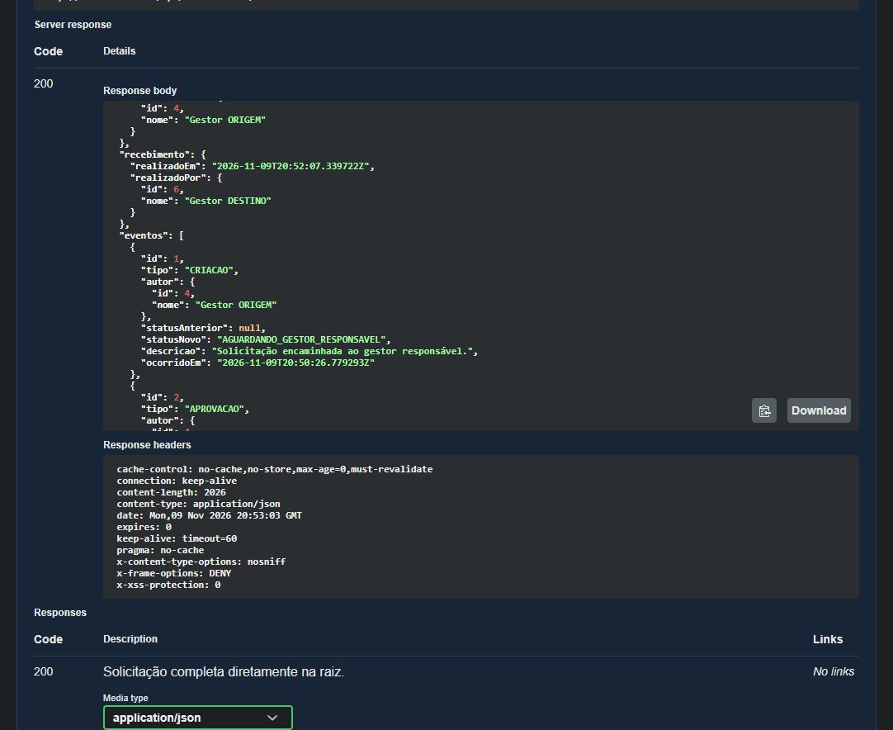

# Ações de solicitações pela API

As cinco ações usam a identidade do JWT e retornam `200` com a solicitação
completa atualizada. O [contrato v1.1](contratos-api-v1.1.md) é a referência de
rotas, permissões e erros. Os services e as migrations foram preservados.

Se o backend já estava iniciado antes de compilar esta entrega, reinicie-o
com a versão atual. Em Docker, reconstrua a imagem e recrie somente o
contêiner do backend conforme o [guia operacional](docker-backend.md).
Executar os testes não atualiza automaticamente um processo ou contêiner antigo.

## Aprovar as duas etapas

1. Crie um pedido com COMUM ou ADMINISTRADOR. Consulte o detalhe e copie o ID
   da aprovação pendente em `GESTOR_AREA`.
2. Faça login com o gestor designado para essa etapa e atualize o Authorize
   do Swagger ou o token do Insomnia.
3. Envie `POST /api/solicitacoes/{solicitacaoId}/aprovacoes/{aprovacaoId}/aprovar`,
   sem corpo. O resultado deve ser `AGUARDANDO_GESTOR_RESPONSAVEL`, com a
   primeira aprovação decidida e uma segunda aprovação pendente com outro ID.
4. Repetir a chamada para o primeiro ID deve retornar
   `409 ETAPA_JA_DECIDIDA`, sem aprovar a segunda etapa.
5. Faça login com o gestor de origem designado na segunda aprovação. Use
   esse novo ID na rota para aprovar explicitamente a segunda etapa. O pedido
   deve ficar `APROVADA`; os dados do patrimônio permanecem iguais.

Mesmo quando o gestor é a mesma pessoa nas duas etapas, as duas chamadas
precisam identificar aprovações diferentes. Pedidos abertos por GESTOR
começam diretamente em `GESTOR_RESPONSAVEL`.

Para os cadastros DEMO, o gestor de DEMO-AREA é `gestor.area@simpi.example`,
e o de DEMO-ORIGEM é `gestor.origem@simpi.example`. Consulte o pedido para
confirmar a designação antes de agir. A senha é a informada na execução do
seed; nenhuma senha ou token deve ser incluído como evidência de teste.

## Recusar outro pedido

Use um pedido diferente, ainda aguardando a etapa do gestor autenticado.
Envie `POST /api/solicitacoes/{solicitacaoId}/aprovacoes/{aprovacaoId}/recusar`:

```json
{
  "justificativa": "O equipamento é necessário para a origem."
}
```

Espere `RECUSADA`, decisão de aprovação `RECUSADA` e evento `RECUSA` com a
justificativa. O bem fica disponível para outro pedido, sem alteração de
setor, localização ou responsável. Texto vazio ou só espaços retorna `400`.

## Cancelar um pedido próprio

Faça login com o solicitante do pedido. Envie
`POST /api/solicitacoes/{id}/cancelar`:

```json
{
  "motivo": "A necessidade foi atendida por outro equipamento."
}
```

Espere `CANCELADA` e evento `CANCELAMENTO`. As decisões já tomadas são
preservadas, etapas pendentes não são decididas e o bem fica disponível.
Cancelamento é permitido somente em `AGUARDANDO_GESTOR_AREA`,
`AGUARDANDO_GESTOR_RESPONSAVEL` ou `APROVADA`. Estados finais ou trânsito
retornam `409 ESTADO_INCOMPATIVEL`; outro ator retorna `403`.

## Enviar e receber o bem

1. Use um pedido `APROVADA`, após decidir todas as etapas necessárias.
2. Autentique um usuário ativo do setor de origem preservado no pedido e envie
   `POST /api/solicitacoes/{id}/enviar`, sem corpo. Espere `EM_TRANSITO`, bloco
   `envio` com ator e data UTC e evento `ENVIO`. O cadastro do bem permanece na origem.
3. Repetir o envio retorna `409 ESTADO_INCOMPATIVEL`, sem duplicar eventos.
4. Autentique um usuário ativo do setor de destino preservado e envie
   `POST /api/solicitacoes/{id}/receber`, sem corpo. Espere `CONCLUIDA`, bloco
   `recebimento`, evento `RECEBIMENTO` e nenhuma ação disponível.
5. Consulte o bem: setor, localização e responsável devem corresponder ao
   destino preservado. O usuário que recebeu não substitui o responsável.
   Consulte também o histórico de transferências concluídas do bem.
6. Repetir o recebimento retorna `409 ESTADO_INCOMPATIVEL`, sem duplicar eventos.

Receber antes do envio retorna `409 ESTADO_INCOMPATIVEL`. Usuário fora do setor
exigido retorna `403 ACAO_NAO_PERMITIDA`; o perfil ADMINISTRADOR não dispensa o
vínculo ao setor. Sem token válido, a resposta é `401 NAO_AUTENTICADO`.

## Cuidados na validação

- Os testes de integração usam exclusivamente `simpi_test` e fixtures sintéticas.
- Testes pelo Swagger/Insomnia criam e alteram registros reais do banco de
  desenvolvimento. Não execute a coleção inteira em lote.
- Use pedidos diferentes para demonstrar aprovação, recusa e cancelamento.
- Se uma ação falhar por rede, consulte o detalhe antes de repetir; não presuma
  que o servidor deixou de registrar a decisão.
- O teste HTTP de movimentação completa usa segurança e banco reais, com rollback
  das fixtures ao final. Sua execução não substitui a homologação manual.

## Validação automatizada de envio e recebimento — 09/11/2026

- 145 testes selecionados em `SolicitacaoExecucaoControllerTest`,
  `SolicitacaoAcaoControllerTest`, `SolicitacaoCriacaoControllerTest`,
  `ContratoOpenApiTest` e `TratamentoErrosControllerAdviceTest` passaram.
- 40 testes de integração em `AcoesSolicitacaoHttpIT`,
  `EnvioRecebimentoSolicitacaoServiceIT` e
  `ConcorrenciaEnvioRecebimentoSolicitacaoIT` passaram no PostgreSQL local `simpi_test`.
- As duas execuções terminaram com `BUILD SUCCESS`, sem falhas, erros ou casos
  ignorados. Não representam execução da suíte inteira, CI, deploy ou homologação
  manual pelo Swagger/Insomnia.

### Ajuste da revisão final — 09/11/2026

O mock de validação de IDs não positivos foi alinhado ao campo `solicitacaoId`
retornado pelo service existente. Quatro casos HTTP com o service real cobrem
zero e negativo nas rotas de envio e recebimento, verificando `400 DADOS_INVALIDOS`
e o campo informado na resposta. O código de produção foi preservado.

Na execução após o ajuste, passaram 28 testes de `SolicitacaoExecucaoControllerTest`
e 20 de integração de `AcoesSolicitacaoHttpIT`, sem falhas, erros ou casos
ignorados, com `BUILD SUCCESS`. Essa execução foi limitada às duas classes afetadas.

## Validação manual no Swagger — 09/11/2026

Após limpeza autorizada somente do `simpi_dev`, as migrations V1/V2 foram
reaplicadas e o seed recriou 3 setores, 7 usuários, 3 localizações e 6 bens.
A senha de demonstração está no [guia do seed](seed-desenvolvimento.md).
O `simpi_test` foi preservado.

No backend Docker, foi criada a solicitação `SOL-2026-0001` (`id=1`), pelo
gestor de origem, para transferir `DEMO-ORIGEM-1` (`id=3`) ao DEMO-DESTINO.
Esse perfil exige somente a etapa `GESTOR_RESPONSAVEL`, aprovada explicitamente.

| Caso executado pela interface | Resultado observado |
| --- | --- |
| Login com a senha documentada | 200, gestores de origem e destino autenticados |
| Criação e aprovação | 201 com Location; aprovação 200 e APROVADA |
| Receber com usuário da origem | 403 ACAO_NAO_PERMITIDA, antes e depois do envio |
| Receber com usuário do destino antes do envio | 409 ESTADO_INCOMPATIVEL |
| Enviar com usuário do destino | 403 ACAO_NAO_PERMITIDA |
| Enviar com gestor da origem | 200 EM_TRANSITO; cadastro do bem ainda na origem |
| Repetir envio | 409 ESTADO_INCOMPATIVEL |
| Receber com gestor do destino | 200 CONCLUIDA; cadastro do bem atualizado para o destino preservado |
| Repetir recebimento | 409 ESTADO_INCOMPATIVEL |
| Consulta final do pedido e histórico do bem | Quatro eventos, sem duplicação; uma transferência concluída |

O responsável final do bem é o usuário comum de destino (`id=7`), enquanto
quem recebeu foi o gestor de destino (`id=6`). A consulta do bem confirmou
setor e localização de destino (`id=3`), além de disponibilidade para novo pedido.
Esse é o estado deixado pelos testes; o banco não permanece vazio de solicitações.
O backend normal ficou ativo, sem o perfil de seed, e o contêiner temporário
da carga foi removido. Esta evidência não comprova deploy remoto ou CI.


