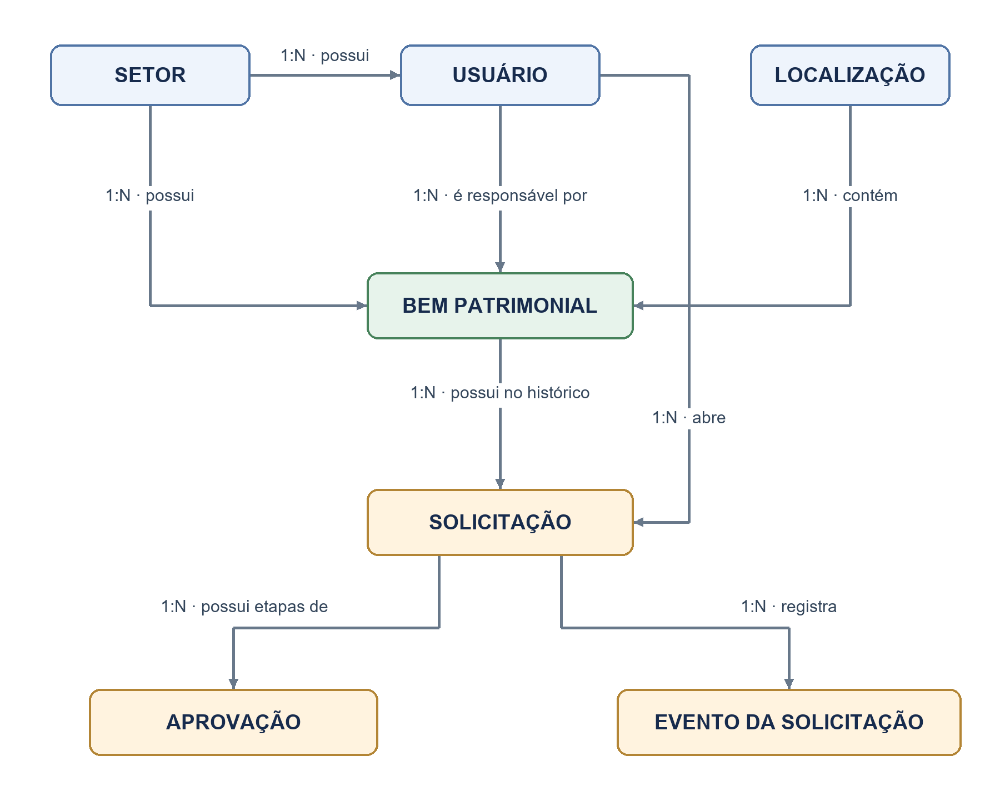

# Regras e fluxos do MVP

Resumo operacional das decisões já registradas no [contrato da API v1.1](contratos-api-v1.1.md), que contém os formatos completos de requisição, resposta e erro. Este resumo não amplia o escopo.

## Escopo

- Um bem por solicitação e apenas uma solicitação ativa por bem.
- Cadastros preparados para demonstração; sem CRUD administrativo completo, anexos ou integração com SCI/ERP.
- Responsável por bem é um usuário do protótipo. Cada usuário pertence a um setor; cada setor possui um gestor designado.
- O gestor designado pertence ao setor gerenciado e possui perfil GESTOR,
  conforme regra original restaurada por confirmação do responsável.
- Localizações são independentes dos setores.
- Bem inativo não pode iniciar uma transferência. O responsável de destino precisa estar ativo e pertencer ao setor de destino.
- Pelo menos setor, localização ou responsável de destino deve diferir da origem.

## Relacionamentos principais

O desenho resume as ligações centrais. As referências adicionais de gestor, aprovador, autor, origem e destino constam no dicionário de atributos. Setor possui usuários e bens; localização contém bens; usuário é responsável por bens e abre solicitações; bem possui solicitações no histórico; solicitação possui aprovações e eventos.

## Caminho principal

| Ator / ação | Condição | Resultado |
| --- | --- | --- |
| Usuário COMUM cria | Bem e destino válidos | AGUARDANDO_GESTOR_AREA; primeira aprovação pendente e evento CRIACAO |
| Usuário GESTOR cria | Bem e destino válidos | AGUARDANDO_GESTOR_RESPONSAVEL; somente a etapa necessária é criada |
| Gestor designado aprova GESTOR_AREA | Aprovação pendente e estado correspondente | AGUARDANDO_GESTOR_RESPONSAVEL; criar segunda aprovação pendente |
| Gestor designado aprova GESTOR_RESPONSAVEL | Aprovação pendente e estado correspondente | APROVADA |
| Usuário ativo do setor de origem envia | APROVADA | EM_TRANSITO; registrar ator, data e evento ENVIO |
| Usuário ativo do setor de destino recebe | EM_TRANSITO | CONCLUIDA; atualizar cadastro do bem, ator, data e evento RECEBIMENTO |

O gestor da primeira etapa é o designado para o setor do solicitante. O da segunda etapa é o gestor designado para o setor de origem do bem. Autoaprovação é permitida quando o solicitante é o aprovador designado. Se o mesmo gestor ocupa as duas etapas, precisa tomar duas decisões explícitas. Pedidos criados por gestor não recebem uma primeira etapa ficticiamente aprovada.

## Recusa e cancelamento

- Gestor designado pode recusar sua etapa pendente, com justificativa obrigatória. Solicitação passa para RECUSADA.
- Somente o solicitante pode cancelar, com motivo obrigatório, enquanto aguarda uma aprovação ou está APROVADA e ainda não foi enviada.
- Não há cancelamento após o envio, reabertura ou reversão de estados finais no MVP.
- RECUSADA, CANCELADA e CONCLUIDA são estados finais; pedidos nesses estados não bloqueiam nova solicitação do bem.
- Recusa e cancelamento preservam o cadastro do bem e o histórico de decisões.

## Dados históricos e consistência

- Origem do bem e setor do solicitante são preservados na abertura; destino proposto fica registrado no pedido.
- O backend determina solicitante, atores, datas, estado e aprovações; não aceita esses dados como autoridade do cliente.
- Criar pedido, aprovação inicial e evento é uma única transação.
- Cada ação deve revalidar usuário, permissão, estado e disponibilidade durante sua execução.
- O cadastro atual do bem só muda no recebimento. Atualizar o bem, concluir o pedido e registrar o evento ocorre na mesma transação.
- Eventos são acrescentados, sem edição ou exclusão pela aplicação.
- Histórico de transferências deriva dos pedidos concluídos e de suas referências preservadas; não do cadastro atual do bem.
- Nenhum clique repetido ou requisição concorrente pode duplicar eventos, criar dois pedidos ativos ou decidir a próxima etapa involuntariamente.
- Aprovar e recusar identificam solicitacaoId e aprovacaoId. A mesma aprovação repetida não decide outra etapa.
- Não há Idempotency-Key obrigatório nem cache de respostas nesta versão. Em perda de resposta, consultar o estado atual antes de tentar novamente.

## Permissões de consulta e sessão

- Todas as operações do catálogo exigem autenticação, exceto POST /api/auth/login.
- Usuários autenticados consultam bens; pedidos ficam visíveis aos setores participantes e ao administrador conforme o contrato.
- ADMINISTRADOR tem consulta global, sem receber automaticamente o direito de aprovar, enviar ou receber.
- Abertura de solicitação por ADMINISTRADOR ainda não foi definida; não disponibilizar automaticamente.
- JWT com validade inicial configurável de 60 minutos. Verificar assinatura, expiração e usuário ativo, perfil e setor atuais em cada requisição.
- Token somente em memória do frontend; atualizar a página exige login novamente, limitação aceita no MVP.
- Logout local não revoga o token. Não há refresh token nesta versão.
- Senhas são armazenadas com hash BCrypt; não registrar senhas ou tokens nos logs.

## Regras para testes prioritários

Validar fluxo comum, caminho de gestor, autoaprovação, duas decisões do mesmo gestor, recusa e cancelamento. Verificar bloqueio por ator incorreto, ação em estado inválido, repetição e concorrência. Comprovar que o bem permanece inalterado antes do recebimento e que falhas de gravação provocam rollback de toda a operação.
